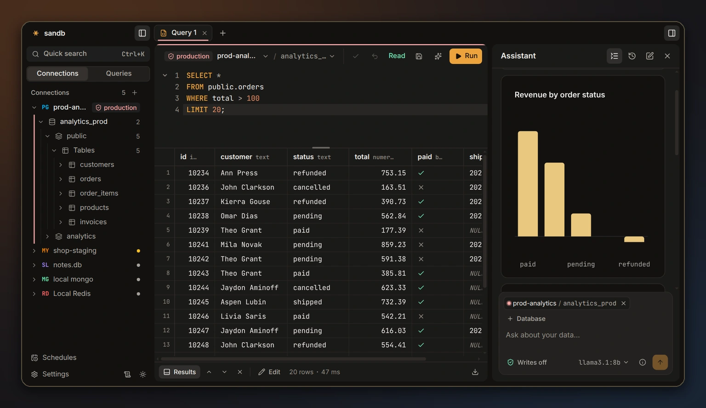

<p align="center">
  
</p>

<h1 align="center">sandb</h1>

<p align="center"><strong>Your databases. Your AI.</strong></p>

<p align="center">
  A desktop database client for writing queries, exploring data, and building charts<br>
  with a local or hosted model you choose.
</p>

<p align="center">
  <strong><a href="https://github.com/ihsanbudiman/sandb/releases/latest">Download for macOS</a></strong>
  <br>
  <a href="https://db.sanlab.dev/">Website</a>
  &nbsp;·&nbsp; <a href="docs/FEATURES.md">Feature guide</a>
  &nbsp;·&nbsp; <a href="CHANGELOG.md">Changelog</a>
</p>

<p align="center">
  
  <br><sub>The sandb workspace, shown with demo data.</sub>
</p>

## What you can do

- **Go from schema to result.** Browse tables, collections, and keys. Run SQL, mongosh-style statements, or Redis commands in tabs, then inspect, edit, and export results.
- **Ask questions across databases.** Use your own model and API key with OpenAI-compatible providers (including Ollama and LM Studio) or Anthropic-compatible providers. Turn results into charts and reports.
- **Control what can write.** Mark connections read-only or turn on write protection for manual SQL commits and confirmation before risky changes. AI writes are off by default and require your approval when enabled.
- **Reuse your work.** Save queries, schedule queries or AI prompts while sandb is open, and share selected connections read-only with external tools over MCP.

## Supported databases

| Type | Engines |
| --- | --- |
| SQL | PostgreSQL, MySQL, MariaDB, SQLite |
| Document | MongoDB (standalone, replica set, or sharded) |
| Key-value | Redis (standalone, Cluster, or Sentinel) |

## Get started

1. Open the [latest release](https://github.com/ihsanbudiman/sandb/releases/latest) and choose a macOS disk image under **Assets**: `_aarch64.dmg` for Apple Silicon or `_x64.dmg` for Intel.
2. Open sandb, add a connection, and run a query. You don't need an AI provider to use the editor.
3. To use the assistant, open **Settings → AI** and enter your provider, base URL, model, and API key if required.

See the [feature guide](docs/FEATURES.md) for editor behavior, database-specific safeguards, exports, and MCP.

## Build from source

Install [Node.js 22](https://nodejs.org/), [pnpm 11](https://pnpm.io/installation), Rust 1.90 or later, and the [Tauri prerequisites](https://v2.tauri.app/start/prerequisites/) for your platform.

```sh
pnpm install --frozen-lockfile
pnpm tauri dev
```

Run `pnpm dev` instead to open the browser workspace with demo data. To bundle the desktop app without updater signing keys:

```sh
pnpm tauri build --config '{"bundle":{"createUpdaterArtifacts":false}}'
```

Find the bundle in `src-tauri/target/release/bundle/`. For architecture-specific builds and signing, see the [release guide](docs/RELEASING.md).
