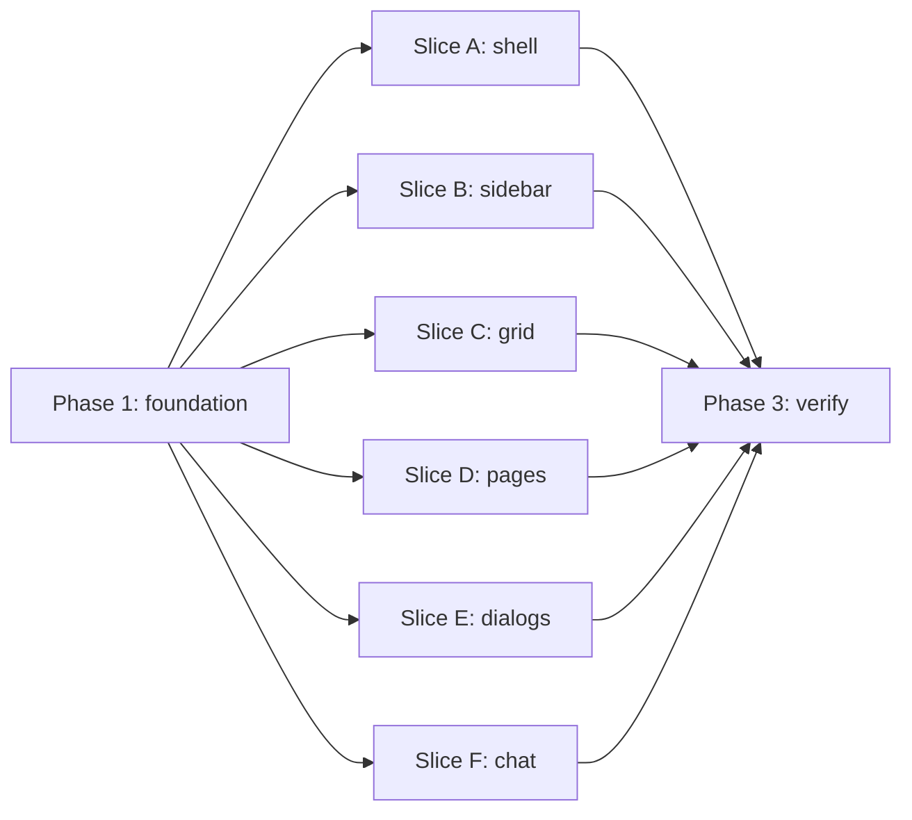

# sandb: UI polish plan

Date: 2026-11-19. Scope: the Svelte frontend (`src/app.css`, `src/App.svelte`, `src/lib/components/*.svelte`, layout stores in `src/lib/*.svelte.ts`). No backend change.

## 1. Why the UI feels clunky

The audit used the demo build (`pnpm dev`, mock backend) at 1440×900 and 1024×680, in dark and light themes. Two code scouts checked all components. The full scout reports are in `agent://DesignSystemAudit` and `agent://InteractionAudit` for this session.

Main causes:

1. **Bugs that move the window.** The title bar scrolls out of view after a click in the tree. The sidebar text moves 4px between states. The Commit and Rollback labels show, then go away after a run.
2. **Too much chrome.** The query view has four stacked bars under the editor (result tabs, grid footer, a second "Results" bar, toolbar). A production connection shows red in five places.
3. **No design rules.** The code uses 9 font sizes, 8 icon sizes, 6 menu widths, 3 menu row heights and about 80 raw red/amber/green color pairs. Six toggle switches are copies of each other with different sizes.
4. **Native parts in a custom UI.** 20 native `<select>` and 7 `window.confirm()` calls.
5. **No motion and weak keyboard support.** Panels, pages, menus and dialogs snap open. Menus have no arrow keys and no focus. Buttons have no focus ring. Dialogs do not trap focus.
6. **Layout does not stay.** Sidebar width, chat width, editor split and panel state reset after a reload. At 1024px the editor is only about 430px wide.

## 2. Rules for all work

- Do not change backend code, `src/lib/api/**`, or behavior that is not in this plan.
- Use the tokens and utilities from Phase 1. Do not add new `text-[Npx]`, raw `red-*/amber-*/emerald-*` colors or new `z-*` values.
- Keep all `aria-label`, `title` and safety prompts (production confirm, read-only guard, pending transaction prompt).
- Respect `motion-reduce` for all new transitions. Keep transitions at 120–180ms.
- Do not run git commands that change state.
- Each agent edits only the files in its slice. If an agent needs a change in another slice, it sends a message to the owner.
- At the end of each phase: `pnpm check` with 0 errors and 0 warnings, and `pnpm build` passes.

## 3. Phase 1: foundation (one agent, before all other phases)

Owner files: `src/app.css`, `src/lib/components/SqlEditor.svelte`, `src/lib/components/Modal.svelte`, `src/lib/ask.svelte.ts`, `src/lib/components/AskHost.svelte`, new files in `src/lib/components/ui/`.

### 3.1 Bug: the title bar scrolls away (High)

- Cause: `SqlEditor.svelte:379` `tooltips({ parent: document.body })`. CodeMirror puts a div with the editor theme classes on `<body>`. The theme rule `& { height: 100% }` gives it 900px, so `body.scrollHeight` is 2× the window. `scrollIntoView` (`App.svelte:185`) then scrolls the body.
- Fix: use `tooltips({ parent: <component root el> })` or remove `parent`. Tooltips are `position: fixed`, so the overflow of the parent does not clip them. In `app.css`, change `html, body { overflow: hidden }` to `overflow: clip`.
- Check: after a click on "local mongo" in the tree, `document.body.scrollHeight === innerHeight` and `document.body.scrollTop === 0`.

### 3.2 Tokens in `@theme`

- Type scale: `--text-2xs: 10.5px`, `--text-xs: 11.5px`, `--text-sm: 12.5px`, `--text-base: 13px`, `--text-lg: 14px`. Map 9.5→2xs, 11→xs, 12→sm, 15→lg.
- Semantic colors, with light and dark values: `danger`, `danger-soft`, `warn`, `warn-soft`, `ok`, `ok-soft`. Point `envDot`/`envTag` (`connections.svelte.ts:22-33`) at these tokens.
- Heights: page header 48px (`h-12`), pane header 44px (`h-11`), sub-toolbar 36px (`h-9`), list row 26px, rich menu row 32px.
- z-index scale: sticky 10, running overlay 20, chat overlay 30, menu 40, dialog 50, toast 60.
- Icon sizes: 12 (next to xs text), 13 (default), 15 (dialog head, page header). Write these in a comment in `app.css`.

### 3.3 Utilities in `app.css`

- `btn-sm` (h-6, px-2, text-xs), `input-sm` (h-7, text-sm), `btn-danger`, `nav-item-danger`, `btn-on` (pressed state with `aria-pressed`), `menu-item` (26px row, used in all popovers), `chip`/`chip-on`, `th` (table header label).
- Focus ring on `btn`, `nav-item`, `seg-item`, `menu-item`, `chip`, tabs: `focus-visible:outline-2 outline-offset-1 outline-accent/60`.
- `[aria-invalid="true"]` on `input`: danger border and ring.
- Global `accent-color: var(--c-accent)` on checkbox, radio and range.

### 3.4 Shared components (`src/lib/components/ui/`)

- `Switch.svelte`: one size (h-5 w-9) and a `size="sm"` option, focus ring, `role="switch"`, `aria-checked`.
- `Select.svelte`: a button and a `popover` listbox. Use `ModelPicker.svelte:63-129` as the reference. Arrow keys, type-ahead, Enter, Escape, focus return.
- `Menu.svelte` (or a `use:menu` action): focus the first item on open, ↑/↓/Home/End/Enter/Escape, focus returns to the trigger, position from `getBoundingClientRect` with flip and clamp (no fixed numbers like `innerHeight - 474`). Fade/scale-in 120ms.
- `EmptyState.svelte`: icon, title, hint, optional action.
- `PageHeader.svelte`: back button, title, subtitle, actions slot.
- `ConfirmDialog` through `ask()`: title, body, confirm label, `destructive` flag. Returns a promise.

### 3.5 `Modal.svelte`

- Focus the `[data-autofocus]` element, else the first focusable element, on open. Trap Tab. Return focus to the last active element on close.
- Fade the backdrop and scale/fade the dialog (150ms).

## 4. Phase 2: slices (parallel, after Phase 1)

### Slice A: app shell and layout

Owner files: `src/App.svelte`, `src/lib/state.svelte.ts`, `src/lib/run.svelte.ts`, `src/lib/chat.svelte.ts` (only the `ui.chatOpen` lines), `src/lib/components/GridToolbar.svelte`, `src/lib/components/TableFilterBar.svelte`, `src/lib/components/NoticeToast.svelte`, `src/lib/notice.svelte.ts`.

1. **Results chrome (High).** Merge the bottom "Results" bar (`App.svelte:924-928`) into `GridToolbar`. Result tabs stay above the grid only when there is more than one result. `TableFilterBar` shows one "Filter" button with a count until the user adds a filter.
2. **`run()` must not force `ui.resultsOpen = true`** when the user hid the results (`run.svelte.ts:110`). Open it only when no result exists.
3. **Commit/Rollback labels (High).** Remove the `@[16rem]` container query (`App.svelte:826-832`). Use one rule for the full toolbar: labels show at `xl` and up, else icon + tooltip. Give the transaction group a fixed width, so it does not move during a run.
4. **Splitter (High).** Show a visible 3px grab line in the 8px sash (`App.svelte:884-892`). Move the maximize/restore buttons to the result toolbar.
5. **Persist layout (High).** Save `sidebarWidth`, `chatWidth`, `editorSplit`, `sidebarOpen`, `chatOpen`, `resultsOpen`, `sidebarView` with `autosave('sandb.layout', …)` and load them with `readStored` (same pattern as `persist.svelte.ts`).
6. **Narrow windows (High).** Clamp the chat width to `min(ui.chatWidth, innerWidth - 560)`. Below 1100px, show the chat as an overlay. Lower the minimum widths: chat 280→240, sidebar 160→140.
7. **Pages (High).** Settings, Schedules and Audit use `PageHeader`. Keep the last tab visible as active in the tab strip (`App.svelte:683`); the page shows over the tab content. Fade the page swap (150ms).
8. **Production cues.** Keep all production cues (user decision). Only move the hard-coded reds (`App.svelte:686,767`) to the `danger` token.
9. **Tab strip (Med).** `role="tablist"`/`role="tab"`, ←/→ keys, edge fade when tabs overflow, a tab context menu (Rename, Close, Close others) with `Menu`.
10. **Editor context menu** (`App.svelte:944-957`): use `Menu`.
11. **Native confirms** at `App.svelte:221,222,334,347`: use `ConfirmDialog`.
12. **Chat panel** (`App.svelte:933`): keep it mounted and hide it with `hidden`, so the draft text stays. Slide it in and out (160ms). Remove the forced `ui.chatOpen = true` in `chat.svelte.ts:122,344` when the user closed the chat on purpose (keep it for an explicit "Ask AI" action).
13. **Toast (Med).** Move to the bottom-right of the main card. Keep a queue of up to 3. Slide/fade in.
14. **Busy feedback (Med).** Show a spinner on the trigger for `tableAction` (`App.svelte:639-653`), `switchConn`/`switchDb`.
15. Sidebar nav (`App.svelte:731,734`): remove `-mx-1`, add `scrollbar-gutter: stable`.
16. Use the Phase 1 tokens, utilities and icon sizes in all owned files.

### Slice B: sidebar

Owner files: `src/lib/components/ConnectionTree.svelte`, `src/lib/components/SavedQueries.svelte`, `src/lib/connections.svelte.ts`.

1. All tree rows 26px (now 24, 26 and 28). Set `pad0` to 8 so tree rows line up with the header and footer (`ConnectionTree.svelte:166`).
2. Production rail (`rootGuide`, `ConnectionTree.svelte:174`): keep it (user decision). Use the `danger` token for its color.
3. Connection and table menus, saved query menu: use `Menu` and `nav-item-danger`. The menu must not cover its own row.
4. Table rows: keep double-click to open (user decision). Keep `picked` highlight in sync with the active tab, and clear it when another tab is active.
5. SavedQueries filter and rename boxes: `input-sm`. Engine badge: one class for all engine badges (see Slice F).
6. Use the Phase 1 tokens and icon sizes.

### Slice C: results grid and table properties

Owner files: `src/lib/components/ResultsGrid.svelte`, `GridCellEditor.svelte`, `JsonTree.svelte`, `QueryRunning.svelte`, `TableProperties.svelte`, `ErDiagram.svelte`, `src/lib/edits.ts`.

1. **Grid context menu always (Med).** On a read-only result too: Copy cell, Copy row(s), Copy column, Copy as CSV. Edit items show only in edit mode. Use `Menu`.
2. Allow text selection in a cell detail view, or add "Copy value" on hover.
3. **Keep grid state** when the user switches result tabs (`App.svelte:917` `{#key}`): key by result object, or cache `columnWidths`, scroll and selection for each result. Coordinate the `App.svelte` line with Slice A.
4. Spinner in the cell while `loadingCell`.
5. FK follow button: add `focus-visible:opacity-100` (`ResultsGrid.svelte:778`).
6. Native confirms at `edits.ts:13` and `ResultsGrid.svelte:243`: use `ConfirmDialog`.
7. `GridCellEditor` select: use `Select`. Error state: `aria-invalid`, not `outline-red-500`.
8. TableProperties: remove the footer that repeats the table name (refresh moves to the section header). Use `EmptyState`.
9. Use the Phase 1 tokens, utilities and icon sizes.

### Slice D: full pages

Owner files: `src/lib/components/SettingsPage.svelte`, `SchedulerPage.svelte`, `AuditPage.svelte`, `ScheduleRunOutput.svelte`.

1. `PageHeader` on all three pages (now three copies, and a fourth back style at `SchedulerPage.svelte:92`).
2. Switches: `Switch` (now 5 copies in these files, two sizes).
3. Native selects (`AuditPage.svelte:81`): `Select`. Audit search box must not cut the placeholder: "Search SQL or connection" fits, or shorten to "Search".
4. Empty states: `EmptyState`. Schedules empty state: one "New schedule" button only (now two).
5. Clickable rows (`AuditPage.svelte:112`, `SchedulerPage.svelte:224`): a real `<button>` expander in the first cell.
6. `window.confirm` at `SchedulerPage.svelte:71`: `ConfirmDialog`.
7. Settings: center the content column (max-w-3xl) so the page does not leave a large empty right side.
8. `ScheduleRunOutput.svelte:48`: remove `uppercase tracking-wide`, use `label`.
9. Use the Phase 1 tokens, utilities and icon sizes.

### Slice E: dialogs

Owner files: every `src/lib/components/*Dialog.svelte`, `ProdAck.svelte`.

1. Danger buttons: `btn-danger` (`DeleteConnectionDialog:47`, `MongoWriteDialog:51`, `TableDangerDialog:64`, `SchemaFormDialog:118`).
2. Native selects: `Select` for short fixed lists (`ConnectionDialog` SSL mode and auth, `ExportSqlDialog`, `MongoSchemaDialog`, `SchemaChangeDialog`, `ScheduleDialog` frequency and days). Long dynamic lists (connection and database pickers in `ScheduleDialog`) can stay native, but with the same chevron and height.
3. Switches: `Switch` (`ConnectionDialog:355,427`, `ScheduleDialog:343`).
4. ConnectionDialog: one font for all text fields (now Name is sans and Host is mono; use mono only for host, port, URI). Put the Test result next to the "Test connection" button. Make the dialog scroll inside its body, so the footer stays visible at 680px height.
5. Use `btn-sm`, `input-sm`, tokens, icon size 15 in the head.
6. Each dialog sets `data-autofocus` on its first field or on Cancel for destructive dialogs.

### Slice F: chat, palette and small widgets

Owner files: `ChatPanel.svelte`, `ChatComposer.svelte`, `ChatScope.svelte`, `ChatTranscript.svelte`, `ModelPicker.svelte`, `TargetBar.svelte`, `TargetBadge.svelte`, `CommandPalette.svelte`, `Markdown.svelte`, `ReadOnlyBadge.svelte`, `ChartView.svelte`, `src/lib/chatTools.ts`.

1. All popover rows: `menu-item` (now 26, 28 and 32px). Menus: `Menu`.
2. Chips (`ChatComposer.svelte:152`, `ChatScope.svelte:66`, `ChatTranscript.svelte:173`): `chip`.
3. One `EngineBadge` look for all engine badges (also used by Slice B and E; Slice F creates `ui/EngineBadge.svelte` and tells the other slices).
4. One status color map for ok/error/blocked (`chatTools.ts:60-65`); Slice D uses it for the audit and the scheduler.
5. Composer: put "Writes off", model picker, info and Send on one clean row with equal gaps. The "+ Database" row merges into the scope chips row.
6. `ChatTranscript.svelte:180`: the "Show less" chevron points left; it must point up.
7. Run menu (`ChatPanel.svelte:46-66`): open at once with a spinner while `classify` runs.
8. Use the Phase 1 tokens, utilities and icon sizes.

## 5. Phase 3: verify (one agent, after Phase 2)

1. `pnpm check` (0 errors, 0 warnings) and `pnpm build`.
2. Browser check on `pnpm dev` (demo backend) at 1440×900 and 1024×680, dark and light. Take screenshots to `.shots/ui-polish/` of: query tab with results, table data tab, Properties, Settings, Schedules, Audit, palette, connection dialog, tree context menu, grid context menu, chat with a reply.
3. Checks:
   - After a click on each tree root, `document.body.scrollTop === 0`.
   - Commit/Rollback do not change size before, during and after a run.
   - Sidebar text does not move between Connections, Queries and the pages.
   - Layout widths stay after a reload.
   - Tab key shows a focus ring on every button, tab, tree row and menu item. Menus work with arrow keys and Escape returns focus.
   - No `window.confirm` in `src/` (`rg "confirm\(" src`).
   - No `text-\[` and no raw `red-|amber-|emerald-` classes in `src/lib/components` and `src/App.svelte` (except token definitions in `app.css`).
4. Add a CHANGELOG entry for the UI changes.

## 6. Order

## 7. Decisions (confirmed by the user, 2026-11-19)

| Item | Decision |
|---|---|
| Production cues | Keep all of them. Only move their colors to the `danger` token. |
| Tree table click | Keep double-click to open. |
| Pages (Settings, Schedules, Audit) | Keep the last tab active in the strip; page shows over it with `PageHeader`. |
| Native selects | Replace short fixed lists with `Select`; keep native for long dynamic lists. |
